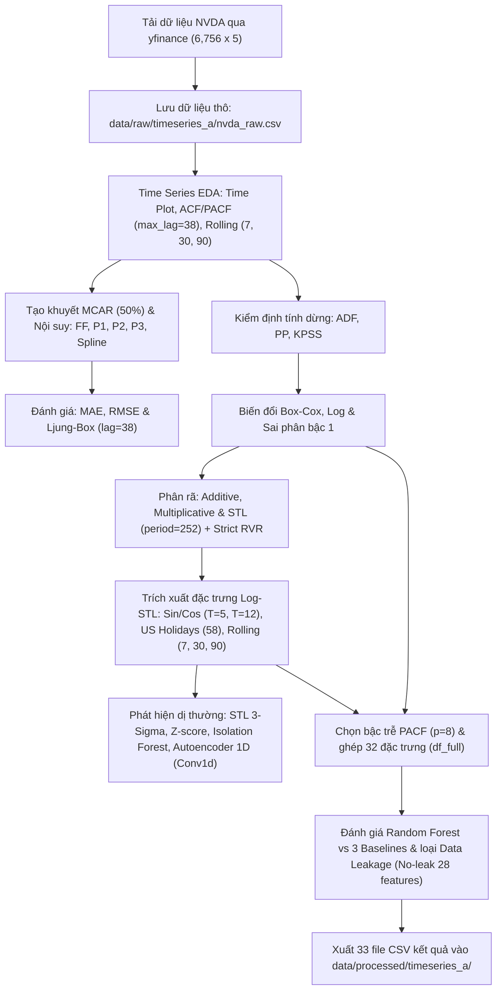

# Đồ án Tiền xử lý Dữ liệu — Phần (a): Dữ liệu Chuỗi thời gian

> **Phạm vi:** Phân tích thống kê khám phá (EDA), kiểm định giả thuyết thống kê, thiết kế pipeline tiền xử lý có kiểm soát, trích xuất đặc trưng, phát hiện dị thường và đánh giá định lượng trên mô hình dự báo đối với dữ liệu **Chuỗi thời gian (Time Series)**.

---

## 1. Giới thiệu & Mục tiêu đồ án

Tiền xử lý dữ liệu là một quy trình kỹ thuật đòi hỏi nền tảng **thống kê toán học**, **lập luận phân tích phê bình** và **thiết kế pipeline tái sản xuất được**. Cuốn Jupyter Book này trình bày hoàn chỉnh quy trình thực nghiệm cho **Phần (a) — Dữ liệu chuỗi thời gian** trên chuỗi giá cổ phiếu **NVIDIA (`NVDA`)** giai đoạn `2000-01-03` – `2026-11-11`:

1. **EDA Chuỗi thời gian:** Phân tích Time Plot, cấu trúc tự tương quan **ACF/PACF** (`max_lag = 38`, tính PACF bằng đệ quy Durbin-Levinson cho hệ Yule-Walker) và thống kê trượt đa tỉ lệ ($W \in \{7, 30, 90\}$).
2. **Điền khuyết có kiểm soát:** Tạo khuyết **MCAR** (`50%`), đối chiếu `Forward Fill`, `Linear`, `Quadratic`, `Cubic` và `Cubic Spline` theo `MAE`, `RMSE` cùng kiểm định tự tương quan phần dư **Ljung-Box** ($\text{lag} = 38$).
3. **Kiểm định & Biến đổi tính dừng:** Kết hợp bộ ba kiểm định đối nghịch **ADF**, **Phillips-Perron (PP)** và **KPSS** qua các phép biến đổi **Box-Cox**, **Log** và **Sai phân bậc 1**.
4. **Phân rã chuỗi thời gian:** So sánh phân rã cổ điển (**Additive**, **Multiplicative**) với **STL (LOESS)** (`period = 252`, `seasonal = 9`), phản biện chỉ số RVR bằng **Strict RVR** và chuyển trục phân rã sang thang **Log**.
5. **Trích xuất đặc trưng (Log-STL):** Mã hóa chu kỳ ($\sin/\cos$ với $T_{\text{tuần}} = 5$, $T_{\text{tháng}} = 12$), cờ ngày lễ Mỹ (`holidays.US()`, `58` phiên) và thống kê trượt (`mean`, `std`, `max`, `min`, `skew`) trên `log_resid`, `log_detrended`, `log_deseasonalized`.
6. **Phát hiện dị thường đa góc nhìn:** Đối chiếu 4 kỹ thuật — **STL $3\sigma$** (`248` điểm), **Z-score** (`324` điểm), **Isolation Forest** đơn (`68` điểm) vs đa tỉ lệ (`67` điểm, đồng thuận `99.21%`) và mạng tích chập **Autoencoder 1D** (PyTorch `Conv1d`, cửa sổ trượt `30` ngày).
7. **Đánh giá định lượng & Kiểm chứng Data Leakage:** Xây dựng ma trận `32` đặc trưng (`p = 8` từ PACF trên `log_diff_1`), huấn luyện `RandomForestRegressor` so với 3 baseline (`Raw Price`, `Naive`, `Return-only`), kiểm chứng *look-ahead bias* của STL toàn chuỗi và thiết lập mô hình chuẩn **No-leak** (`28` đặc trưng nhân quả).

---

## 2. Đặc tả Tập dữ liệu

- **Tên tập dữ liệu:** Dữ liệu giao dịch theo ngày cổ phiếu **NVIDIA (`NVDA`)**
- **Nguồn thu thập:** `yfinance` (`yf.download("NVDA", start="2000-01-01", end="2026-11-12")`), tham chiếu công khai từ [Stock Market Data trên Kaggle](https://www.kaggle.com/datasets/paultimothymooney/stock-market-data)
- **Khoảng thời gian:** `2000-01-03` đến `2026-11-11` (`6,756` phiên giao dịch ngày làm việc)
- **Kích thước dữ liệu thô:** `6,756` dòng × `5` cột (`~316.7 KB`), không có giá trị thiếu tự nhiên (`0` missing)

| Thuộc tính | Kiểu dữ liệu | Mô tả |
| :--- | :--- | :--- |
| `Date` (Index) | `DatetimeIndex` | Ngày giao dịch trên sàn chứng khoán Mỹ (`0` phiên vào T7/CN) |
| `Close` | `float64` | Giá đóng cửa điều chỉnh (từ `0.089206` đầu năm `2000` lên vượt `186` cuối `2026`) |
| `High` | `float64` | Giá cao nhất trong phiên |
| `Low` | `float64` | Giá thấp nhất trong phiên |
| `Open` | `float64` | Giá mở cửa phiên giao dịch |
| `Volume` | `int64` | Khối lượng cổ phiếu khớp lệnh |

---

## 3. Kiến trúc Pipeline Tiền xử lý



---

## 4. Cấu trúc Book & Tổ chức Dữ liệu Phân cấp

```text
data-mining/
├── README.md                                  # Tổng quan, thông tin SV, hướng dẫn cài đặt & build
├── requirements.txt                           # Danh sách phiên bản thư viện môi trường
├── book/                                      # Nguồn cuốn Jupyter Book
│   ├── index.md                               # Trang mở đầu giới thiệu quy trình & pipeline
│   ├── 03_temporal_preprocessing.ipynb        # Notebook cài đặt đầy đủ EDA, tiền xử lý & thực nghiệm
│   └── report.md                              # Báo cáo phân tích định lượng & thảo luận phê bình
└── data/
    ├── raw/
    │   └── timeseries_a/
    │       └── nvda_raw.csv                   # Dữ liệu thô OHLCV từ biến df
    └── processed/
        └── timeseries_a/                      # 33 file CSV kết quả từng công đoạn
            ├── se_ff.csv, se_p1.csv, se_p2.csv, se_p3.csv, se_spline.csv          # Điền khuyết & nội suy
            ├── se_box_cox.csv, se_log.csv, box_cox_diff_1.csv, log_diff_1.csv     # Biến đổi tính dừng
            ├── stl_trend.csv, stl_seasional.csv, stl_resid.csv                    # Thành phần phân rã STL
            ├── detrended.csv, deseasonalized.csv                                  # Khử xu hướng & mùa vụ
            ├── df_detrend_day_extract.csv, df_deseasonal_day_extract.csv          # Chu kỳ tuần (T=5) + lễ
            ├── df_detrend_month_extract.csv, df_deseasonal_month_extract.csv      # Chu kỳ tháng (T=12) + lễ
            ├── df_residual_extract_{7,30,90}.csv                                  # Rolling stats trên log_resid
            ├── df_detrend_extract_{7,30,90}.csv                                   # Rolling stats trên log_detrended
            ├── df_deseasonal_extract_{7,30,90}.csv                                # Rolling stats trên log_deseasonalized
            ├── anomolies.csv, anomaly_z_score.csv                                 # Dị thường STL 3σ & Z-score
            ├── df_iforest_size_30.csv, df_iforest_all.csv, df_compare.csv         # Kết quả Isolation Forest
            └── feat_all.csv                                                       # Tập đặc trưng gộp {7,30,90}
```

### Nội dung các phần trong Book
1. **Trang mở đầu (`index.md`):** Trình bày mục tiêu đồ án, đặc tả dữ liệu `NVDA`, sơ đồ kiến trúc pipeline và sơ đồ tổ chức thư mục dữ liệu.
2. **[Thực hành Tiền xử lý Chuỗi thời gian (03_temporal_preprocessing.ipynb)](03_temporal_preprocessing.ipynb):** Notebook thực thi sạch toàn bộ pipeline EDA, kiểm định thống kê, mô hình `TimeSeriesAutoEncoder` (PyTorch), `RandomForestRegressor` và xuất CSV tự động.
3. **[Báo cáo Phân tích So sánh & Thảo luận (report.md)](report.md):** Tổng hợp đầy đủ các bảng số liệu thực nghiệm mới nhất, đối chiếu định lượng và nhận xét phê bình ở từng công đoạn.
